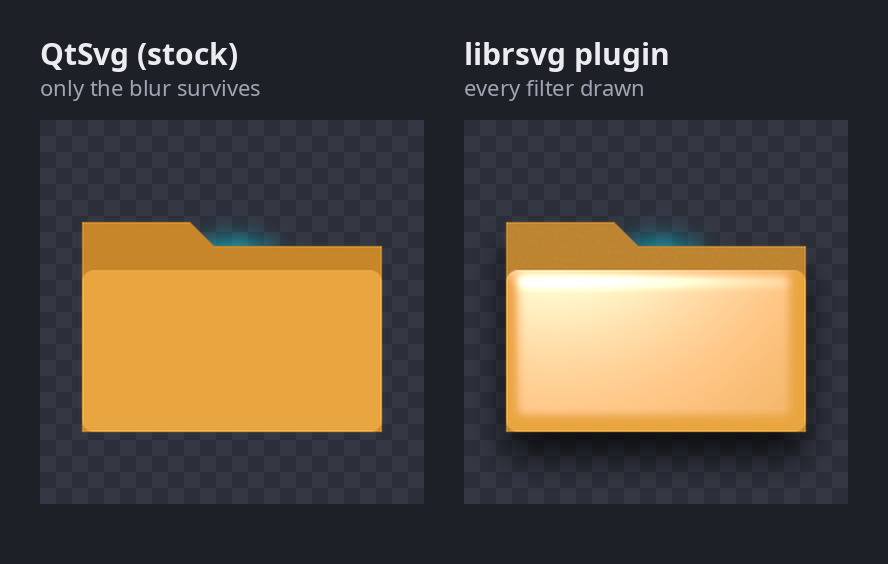
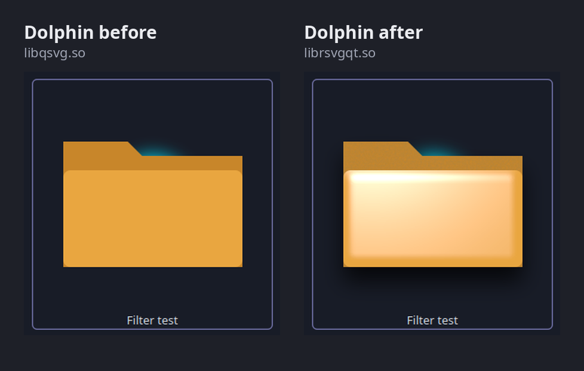
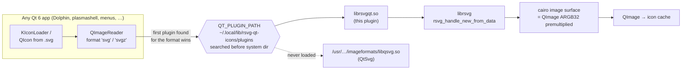

# svg-icon-renderer

A Qt 6 image-format plugin (`librsvgqt.so`) that draws `svg`/`svgz` with librsvg instead of
QtSvg. KDE's icon loader (KIconLoader/KIconEngine) reads SVG icons through `QImageReader`, so with
this plugin your icons get full SVG 1.1 rendering: `feDropShadow`, `feTurbulence`,
`feDiffuseLighting`/`feSpecularLighting`, masks and the rest. QtSvg 6.10 does a few filters (plain
blur, offset, colour matrix, merge), but it drops all of those.



*[`test/filter-test.svg`](test/filter-test.svg) read through `QImageReader` at 256 px, once with the
stock QtSvg plugin and once with this one (the output of `test/compare.py`). QtSvg keeps the cyan
blur glow but drops the specular sheen, the turbulence paper grain on the tab and the drop shadow.*

## Why

Qt's own SVG module implements SVG Tiny 1.2, which has no filter effects beyond a handful of
basics. Icon themes made for GTK desktops, or drawn in Inkscape with shadows and lighting, look
flat or broken in Plasma because of that. librsvg, the renderer GNOME uses, implements full
SVG 1.1 filters. Rather than patching KDE, this swaps the renderer at the one place every Qt app
reads SVG images: the `svg` image-format plugin.

## Features

- Drop-in replacement for Qt's `libqsvg.so` image plugin, for both `svg` and gzip-compressed `svgz`
- Full SVG 1.1 rendering through librsvg and cairo: filters, lighting, turbulence, masks, clipping
- Installs per user under your home folder, no `sudo`, no system files touched; one script to undo
- Thread-safe (one librsvg handle per read), rejects broken or hostile input, never loads
  external files (only `data:` URIs)
- Tests for visual output, every installed icon, broken input, speed and the live session

## Screenshots

A real Dolphin window on a folder whose icon is the filter test, before and after the plugin
(cropped from `test/screenshots/before.png` and `after.png`, made by `test/dolphin-test.sh`):



## How it works



Inside the plugin (`src/rsvgplugin.cpp`):

1. `RsvgPlugin::capabilities()` claims the `svg` and `svgz` formats, and sniffs unnamed data for a
   gzip header or an `<svg` tag.
2. `RsvgHandler::load()` reads the whole device and hands the bytes to
   `rsvg_handle_new_from_data()` with no base file, so references to other files can't be
   resolved. librsvg inflates `svgz` by itself. The intrinsic size comes from width/height, then the
   viewBox, then a 100×100 fallback (QtSvg's).
3. `RsvgHandler::read()` allocates the `QImage` through `QImageIOHandler::allocateImage()`, which
   enforces Qt's allocation limit, wraps its pixels in a cairo surface (cairo's ARGB32 and Qt's
   ARGB32_Premultiplied have the same layout), scales to the requested size the way QtSvg does,
   and renders the document straight into it. No copy.

### How it takes over without touching system files

`install.sh` copies the plugin to `~/.local/lib/rsvg-qt-icons/plugins/imageformats/` and adds
`~/.config/plasma-workspace/env/rsvg-qt-icons.sh`, which puts that folder first on `QT_PLUGIN_PATH`
for the Plasma session. When two plugins claim the same format, Qt uses the first one it finds,
and `QT_PLUGIN_PATH` folders are searched before the system one. Checked here: with the folder on
the path, `/usr/.../imageformats/libqsvg.so` isn't even loaded. It also deletes KDE's icon cache
(`~/.cache/icon-cache.kcache`) so icons rendered earlier by QtSvg get redrawn.

## Install and use

Requirements: Qt 6 (tested with 6.10), librsvg 2.52+ (tested with 2.61), cairo, a C++17 compiler,
and KDE Plasma 6 for the session install. On Ubuntu/Debian:

```bash
sudo apt install qt6-base-dev librsvg2-dev libcairo2-dev pkgconf g++
```

Build, test, install:

```
bash build.sh                       # -> build/imageformats/librsvgqt.so
python3 test/compare.py build test/filter-test.svg build/compare     # renders QtSvg vs plugin, checks the effects
python3 test/stress.py build        # every icon in /usr/share/icons on 8 threads, broken input, speed
bash test/dolphin-test.sh before    # same Dolphin window without the plugin -> test/screenshots/before.png
bash test/dolphin-test.sh after     # real Dolphin window using the plugin -> test/screenshots/after.png
bash install.sh                     # no sudo; takes effect at next login
bash test/check-session.sh          # after login: which svg plugin plasmashell/Dolphin loaded
bash undo.sh                        # back to QtSvg at next login
```

The Python tests need PyQt6 (`sudo apt install python3-pyqt6`). `dolphin-test.sh` needs Dolphin and
Spectacle; it runs Dolphin with its own config and cache folders so your settings and icon cache
are left alone.

To try the plugin in a single app without installing it, point `QT_PLUGIN_PATH` at the build
folder:

```bash
QT_PLUGIN_PATH="$PWD/build" dolphin
```

## Test results (2026-10-28, Qt 6.10.2, librsvg 2.61.3)

- `compare.py`: drop shadow and paper grain present with the plugin, absent with QtSvg, for both
  `.svg` and `.svgz`. PASS.
- `dolphin-test.sh`: the Dolphin process maps `librsvgqt.so` instead of `libqsvg.so`, and the folder
  icon shows the sheen, shadow and grain. See `test/screenshots/before.png` and `after.png`.
- `stress.py`: 43,333/43,333 system icons rendered at 64 px on 8 threads in 2.8 s, no crash. On a
  single thread it takes 1.04 s per 3,000 icons, against 0.73 s for QtSvg. Broken input is
  rejected: empty data, truncated files, garbage gzip, a 100000×100000 px request, and an XML
  entity bomb. A `file://` image reference is not loaded.
- Memory stays flat (about 46 MB) over 6,000 renders of the filter test icon.
- Installed and re-logged in: `test/check-session.sh` shows `QT_PLUGIN_PATH` in the systemd user
  environment, and plasmashell and Dolphin both load `librsvgqt.so`. No plugin warnings in the journal.

## Scope and risks

- Covers everything that loads SVG through `QImageReader`: KDE icons in Dolphin, the task manager,
  menus, Qt `QIcon`s from SVG files. It does not cover Plasma's own theme graphics (panel
  backgrounds, widgets), which KSvg draws with `QSvgRenderer` directly, nor `libqsvgicon.so` users.
- Every Qt app in the session uses it. Each read gets its own librsvg handle, so it is thread-safe.
  Image size is capped by Qt's allocation limit. External files are never loaded: no base path is
  given to librsvg, though `data:` URIs still work.
- librsvg is slower than QtSvg on heavy filters. KDE caches rendered icons, so that cost is paid
  once per icon and size.
- If Plasma ever fails to start, switch to a text console (Ctrl+Alt+F3), log in, run `bash undo.sh`,
  and log back in.

## Project layout

```
src/rsvgplugin.h        QImageIOPlugin + QImageIOHandler declarations
src/rsvgplugin.cpp      the plugin: format sniffing, librsvg load, cairo render into a QImage
src/rsvgplugin.json     plugin metadata: keys svg/svgz and their MIME types
build.sh                checks build packages, runs moc and g++ -> build/imageformats/librsvgqt.so
install.sh              per-user install + Plasma session QT_PLUGIN_PATH setting
undo.sh                 removes both again
test/filter-test.svg    folder icon using turbulence, specular lighting, drop shadow and blur
test/compare.py         renders with and without the plugin and checks the effects appear
test/stress.py          every system icon on 8 threads, broken/hostile input, speed vs QtSvg
test/dolphin-test.sh    screenshots a real Dolphin window before/after
test/check-session.sh   shows which svg plugin the running Plasma apps loaded
test/screenshots/       Dolphin screenshots from dolphin-test.sh
docs/images/            README images
```

## License and privacy

MIT, see [LICENSE](LICENSE). The plugin collects no data and makes no network connections; see
[PRIVACY.md](PRIVACY.md).
