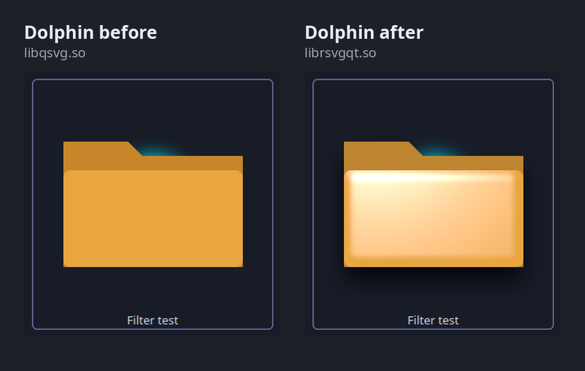
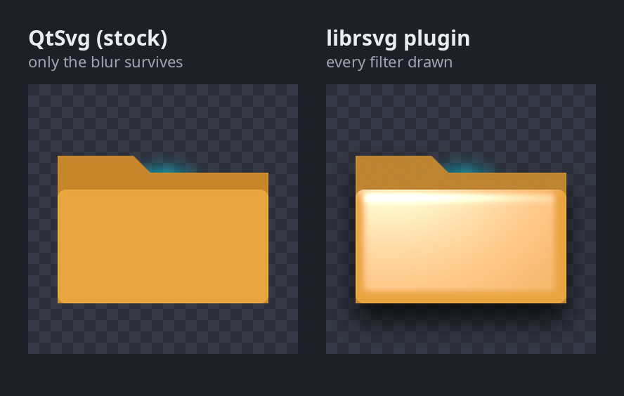
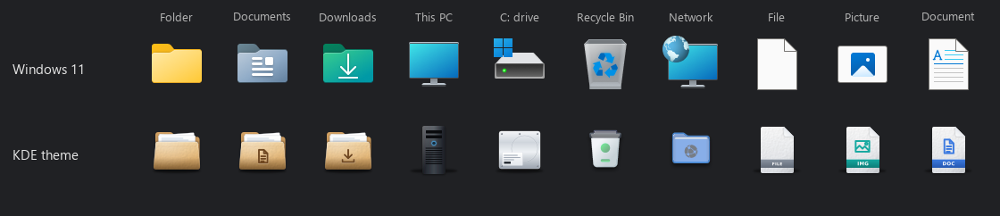

# svg-icon-renderer

[](https://github.com/baverrr/svg-icon-renderer/actions/workflows/ci.yml)
[](https://github.com/baverrr/svg-icon-renderer/actions/workflows/codeql.yml)
[](LICENSE)

A plugin that makes KDE Plasma draw SVG icons with librsvg instead of Qt's own SVG module. Icons with shadows, lighting and textures then look the way their designer drew them.

<p align="center">
  
</p>

> [!TIP]
> Try it in one app without installing: after building, run `QT_PLUGIN_PATH="$PWD/build" dolphin`.

> [!IMPORTANT]
> Once installed, every Qt app in your Plasma session uses it. If Plasma ever fails to start, press Ctrl+Alt+F3, log in, run `bash undo.sh`, and log back in.

**[What it does](#what-it-does)** · **[What you need](#what-you-need)** · **[Install](#install)** · **[How to use it](#how-to-use-it)** · **[Help](#help)**

## What it does

- **Draws full SVG icons.** Qt's SVG module skips most filter effects, so icons made for GTK desktops or in Inkscape look flat. librsvg, the renderer GNOME uses, draws them all: drop shadows, lighting, turbulence, masks and clipping.
- **Swaps in quietly.** It replaces Qt's `svg` and `svgz` image plugin, which is where KDE's icon loader reads SVG icons.
- **Stays in your home folder.** No `sudo` and no system files changed. One script undoes it.
- **Reads files safely.** Each read gets its own librsvg handle, broken or hostile files are rejected, and it never loads other files (only `data:` URIs).
- **Is tested.** Tests cover the drawn output, every installed icon, broken input, speed and the live session.
- **Brings the same icons to Windows.** The [windows](windows/README.md) folder builds a Windows 11 icon theme from your KDE icon theme, used through Windhawk's Resource Redirect mod.

<table>
  <tr>
    <td></td>
  </tr>
  <tr>
    <td align="center">The test icon at 256 px. QtSvg keeps only the blur glow. The plugin also draws the sheen, the paper grain and the shadow.</td>
  </tr>
  <tr>
    <td></td>
  </tr>
  <tr>
    <td align="center">Windows 11's icons, then the same icons from a KDE theme with the Windows icon theme.</td>
  </tr>
</table>

## What you need

- Linux with KDE Plasma 6
- Qt 6 (tested with 6.10) and librsvg 2.52 or newer (tested with 2.61)
- On Ubuntu or Debian, these build packages:

  ```bash
  sudo apt install qt6-base-dev librsvg2-dev libcairo2-dev pkgconf g++
  ```

## Install

1. Download the project:

   ```bash
   git clone https://github.com/baverrr/svg-icon-renderer.git
   cd svg-icon-renderer
   ```

2. Build the plugin. It tells you if a build package is missing:

   ```bash
   bash build.sh
   ```

3. Install it for your user only, no `sudo`:

   ```bash
   bash install.sh
   ```

4. Log out and back in.

## How to use it

1. **Log back in.** Icons in Dolphin, the task manager and menus are now drawn by librsvg.
2. **Check it.** Run `bash test/check-session.sh` to see which SVG plugin Plasma and Dolphin loaded.
3. **Undo it.** Run `bash undo.sh` and log out and back in to go back to Qt's own renderer.

<details>
<summary><b>What it covers and what it doesn't</b></summary>

- It covers anything that loads SVG through `QImageReader`: KDE icons in Dolphin, the task manager, menus, and Qt icons made from SVG files.
- It doesn't cover Plasma's own theme graphics (panel backgrounds, widgets), which KSvg draws another way, or apps that use `libqsvgicon.so`.
- librsvg is slower than QtSvg on heavy filters. KDE caches drawn icons, so the cost is paid once per icon and size.
</details>

## Help

**Icons still look flat.** Log out and back in. The plugin only takes over at login. Then run `bash test/check-session.sh`.

**Plasma won't start.** Press Ctrl+Alt+F3, log in, run `bash undo.sh`, and log back in.

**`build.sh` says packages are missing.** Install the ones it lists with `sudo apt install`.

<details>
<summary><b>For developers</b></summary>

- How it takes over: `install.sh` copies the plugin to `~/.local/lib/rsvg-qt-icons/plugins/imageformats/` and adds `~/.config/plasma-workspace/env/rsvg-qt-icons.sh`, which puts that folder first on `QT_PLUGIN_PATH`. Qt uses the first plugin it finds for a format, so the system `libqsvg.so` is never loaded. It also clears KDE's icon cache.
- The plugin itself: [src/rsvgplugin.cpp](src/rsvgplugin.cpp)
- Run the tests (they need `sudo apt install python3-pyqt6`):

  ```bash
  python3 test/compare.py build test/filter-test.svg build/compare   # QtSvg vs plugin
  python3 test/stress.py build         # every system icon, broken input, speed
  bash test/dolphin-test.sh before     # Dolphin screenshot without the plugin
  bash test/dolphin-test.sh after      # and with it (needs Dolphin and Spectacle)
  ```

- Last results (2026-10-28, Qt 6.10.2, librsvg 2.61.3): all effects present with the plugin; 43,333 of 43,333 system icons drawn on 8 threads in 2.8 s; 1.04 s per 3,000 icons on one thread against 0.73 s for QtSvg; memory flat at about 46 MB over 6,000 renders.
- CI builds on Ubuntu 26.04 and runs `compare.py`, `stress.py` and ShellCheck. The Dolphin and session tests need a Plasma desktop, so they're run by hand.
- The Windows icon theme has its own guide: [windows/README.md](windows/README.md). CI renders a few Adwaita icons with its `render.py`; the Windows-side checks (`build_theme.py`, `check_live.py`) run on Windows by hand.
</details>

## License

MIT. See [LICENSE](LICENSE). The plugin collects no data and makes no network connections. See [PRIVACY.md](PRIVACY.md).
