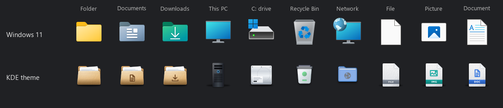

# Windows icon theme

Build a Windows 11 icon theme from a KDE icon theme, so Windows shows the same icons as your Plasma desktop. The theme is used through [Windhawk](https://windhawk.net)'s **Resource Redirect** mod, so no Windows files are changed.

<p align="center">
  
</p>

> [!TIP]
> Turning the theme off is one click: clear the theme path in Resource Redirect's settings and run `refresh-icons.cmd`.

## What it does

- **Replaces 350 of Windows' 367 shell icons.** Folders, user folders, drives, discs, devices, settings, dialogs, toolbar actions and file types, all listed in [icon-map.txt](icon-map.txt).
- **Uses your KDE theme's own lookup.** `render.py` finds each icon the way KDE does: in your theme first, then in the themes it inherits from.
- **Keeps badges small.** The shortcut arrow and the other badges Windows draws over icons are drawn small in the corner, so they don't cover the icon under them.
- **Checks its work.** The build reads every icon back from the new theme file, and `check_live.py` asks Windows for all 367 icons and compares them pixel by pixel.
- **Never breaks the working theme.** A failed build leaves the last good one in place.

## What you need

- Windows 11 with [Windhawk](https://windhawk.net) and its **Resource Redirect** mod
- Python 3.11 or newer on Windows, and Git for Windows (for Git Bash)
- A Linux machine with your KDE icon theme, `rsvg-convert` (`librsvg2-bin`), ImageMagick 7 and Python 3, that you can reach with `ssh`
- A C compiler for one tiny file. Windhawk includes one.

## Install

1. In this folder, set up Python and compile the empty DLL the icons go into:

   ```bash
   python -m venv .venv
   .venv/Scripts/python.exe -m pip install -r requirements.txt
   "/c/Program Files/Windhawk/Compiler/bin/clang++.exe" -x c --target=x86_64-w64-mingw32 -O2 -shared -nostdlib -Wl,-e,DllMain -o empty.dll empty.c
   ```

2. Save a copy of Windows' own icons, used to check the theme:

   ```bash
   .venv/Scripts/python.exe -I dump_icons.py 'C:\Windows\SystemResources\imageres.dll.mun' imageres-dump
   ```

3. Render the icons on your Linux machine. Use its ssh name, and your theme's folder name if it isn't Manila-Folders:

   ```bash
   RENDER_HOST=my-linux-pc ICON_THEME=Manila-Folders bash fetch.sh
   ```

4. Build the theme into a folder of your choice:

   ```bash
   .venv/Scripts/python.exe -I build_theme.py "$USERPROFILE/IconThemes/My-Theme"
   ```

5. In Windhawk, open **Resource Redirect**, **Settings**, add that folder under **Theme paths**, and save.

6. Double-click `refresh-icons.cmd` in this folder to restart Explorer with the new icons. (From Win+R, type its full path; the name alone isn't found.)

## How to use it

1. **Check it.** `.venv/Scripts/python.exe -I check_live.py live-check.png` checks every icon and saves a sheet of Windows, theme and live icons side by side.
2. **Change an icon.** Edit its line in `icon-map.txt`, then run steps 3, 4 and 6 again.
3. **Rebuild any time.** Each build gets a new file name, because Windows won't replace a file Explorer has open. Older builds are deleted once nothing uses them.

<details>
<summary><b>Icons left as they are, on purpose</b></summary>

17 IDs keep Windows' own image: 14, 119, 121, 1013, 1301 to 1303, 5365 and 5369 are see-through placeholders; 1015, 1017 and 1018 are faint shadow layers; 17 and 191 to 194 are the frames Windows draws around picture and video thumbnails. An icon in those places would cover your thumbnails or add clutter where Windows shows almost nothing.
</details>

## Help

**Explorer still shows the old icons.** Run `refresh-icons.cmd`. New programs pick up a new build at once; Explorer only when it restarts.

**Folders with pictures look odd.** Windows draws those from layers. Turn on **Disable folder thumbnails** in Resource Redirect's settings.

**`fetch.sh` says an icon is MISSING.** Your theme and the themes it inherits from don't have that name. Pick another name for that line in `icon-map.txt`.

<details>
<summary><b>For developers</b></summary>

- `render.py` runs on Linux and needs only the standard library. It reads each theme's `index.theme` (folders, their Context and size, and `Inherits`), picks scalable icons first, then the largest size, and packs 10 sizes into each `.ico`. `fetch.sh` sends it over ssh and records which SVG each icon came from in `sources.txt`.
- `build_theme.py` writes the icons into a copy of `empty.dll` with Windows' `UpdateResource` API, reads them back to check every byte, then writes `theme.ini` pointing at the new DLL.
- `check_live.py` loads each icon through `ExtractIconExW`, which Resource Redirect hooks, and compares it with the rendered `.ico` and with Windows' original at 32 and 16 px.
- `unmapped_sheet.py` makes contact sheets of the IDs `icon-map.txt` doesn't list.
</details>
